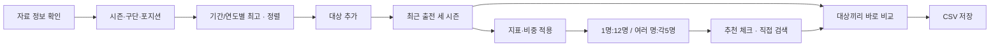

# 스토리보드 — 구현 흐름

[시각 스토리보드](STORYBOARD.html)

| 장면 | 보이는 정보 | 행동과 결과 |
|---|---|---|
| 자료 정보 | 출처·수집일·완료 여부·변환일 | 미확인 정보 확인, 원본 내려받기 |
| 탐색 | 다중 시즌·구단·포지션·최고 범위, 조건 배지 | 배지 해제·초기화·정렬·10개씩 더 보기 |
| 대상 | 선수·기준 시즌·실제 세 시즌·누적 기록 | 추가·시즌 변경·제거, 기존 비교 선택 유지 |
| 추천 | 선수별 추천 그룹·지표 비중 | 비중 적용·기본값 복원·비교 추가. 중복은 안내 |
| 최종 비교 | 대상+비교 사례, 최고/최저 강조 | 대상 두 명만으로도 비교·CSV 저장 가능 |

금색: 선택 범위의 리그 최고. 파랑: 통합 구단 최고. 금색+테두리: 둘 다. 최고 범위는 기간 전체/연도별 선택 가능. 경기 수 제외, 시즌 비율 최고는 규정 타석 충족자만 대상.

최종 비교표의 빨강/파랑은 선택 사례끼리 표시값 최고/최저를 뜻하며, 시즌 최고 색상과 별도다. 모두 같은 값이면 두 색을 표시한다.

예외: 자료 부족·중복 시 기존 선택 유지. 전체 지표 비중 0은 적용 거부. 필터 초기화는 대상/비교 사례를 지우지 않음. 새로고침은 선택 초기화.
